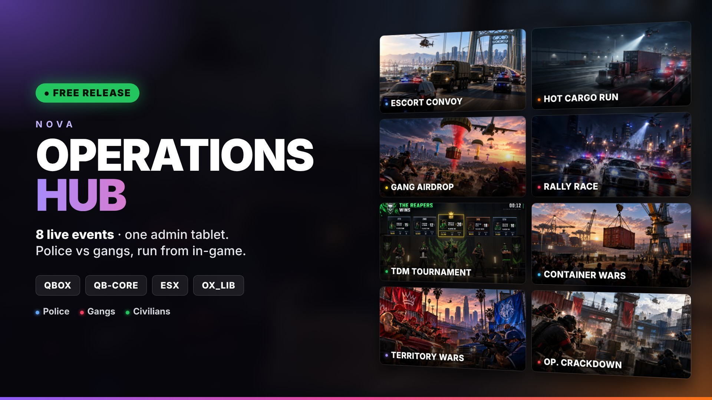

# Nova Operation Command (nova_convoytruck)



**Operations Hub**: a configurable live-event system for FiveM roleplay servers running **Qbox, QB-Core or ESX**.
Admins create and run events from an in-game tablet. Players join as police, gang members or civilians. The script
handles announcements, rewards, gang XP, leaderboards, PDF after-action reports and Discord logs.

## Events

| Event | What happens |
|---|---|
| Escort Convoy | Police escort armored cargo trucks along a route while gangs try to stop them. |
| Hot Cargo Run | Gangs hunt and hijack contraband trucks and deliver them before police catch them. |
| Gang Airdrop | A cargo plane drops loot crates by parachute and gangs fight for them. |
| Rally Race | A checkpoint street race. Finishing positions pay race tokens. |
| TDM Match | Two gangs fight a team deathmatch in an arena or a tournament bracket. |
| Container Wars | A harbour yard where a crane lifts containers and gangs bid for them. |
| Territory Auction | Gangs bid for map territory, grow it with XP and fight rival wars over it. |
| Operation Crackdown | One gang against on-duty police inside a combat zone. |

Also included: a practice range, gang management with roles and XP, a scheduler, a route builder and recorder, a prop
placer, minigames, a live event panel and a full in-tablet user guide (`docs/user_guide.md`).

## Requirements

- [ox_lib](https://github.com/overextended/ox_lib)
- [oxmysql](https://github.com/overextended/oxmysql)
- One framework: `qbx_core`, `qb-core` or `es_extended` (detected automatically)
- Optional: an inventory (`ox_inventory`, `qb-inventory`, `ps-inventory`, `qs-inventory`), detected automatically
- Optional: a banking script (`Renewed-Banking` is supported; others go through `bridge/banking/custom.lua`)

## Installation

1. Copy this folder into your server's `resources/` as **`nova_convoytruck`**. The folder name matters because the
   events and NUI callbacks use it.
2. Import `install.sql` into your database.
3. Add the item `event_status_tablet` to your inventory's item list (or set `Config.StatusPanelItem.enabled = false`).
4. Edit `config/config.lua`. At minimum:
   - `Config.Branding`: your server and operation names, plus optional logo links.
   - `Config.DiscordLogs.webhookUrl`: your Discord webhook. **Keep it private and never commit a real one.**
   - `Config.CreatorAccess.adminIdentifiers`: your own `license:` / `discord:` identifiers.
5. Add to `server.cfg` **after** ox_lib, oxmysql and your framework:
   ```cfg
   ensure nova_convoytruck
   ```

## Usage

| Action | Command | Default key |
|---|---|---|
| Open the Operations Hub tablet (admins / staff) | `/eventhub` | F7 |
| Open the Event Status panel (players) | `/eventstatus` | F6 |

You can change the commands and keys in `Config.Tablet` and `Config.StatusPanel`. The **User Guide** tab inside the
tablet explains every event and setting.

## Project layout

```
fxmanifest.lua      resource manifest
config/             all settings (config.lua) and the prop list
bridge/             framework, inventory, banking, vehicle and gang adapters
client/modules/     client-side logic
server/modules/     server-side logic
shared/             code shared by client and server
data/               harbour layout, prebuilt race tracks, vehicle meta templates
html/               BUILT tablet / HUD interface (what FiveM loads)
web/                Svelte source for the interface
images/ sounds/     event banners and UI sounds
stream/             optional addon vehicle models (see ADDON_VEHICLES.md)
docs/user_guide.md  text of the in-tablet User Guide (edit it live, no rebuild needed)
install.sql         database tables
```

## Rebuilding the interface

`html/` is already built, so you only need this if you change `web/src`:

```bash
cd web
npm install
npm run build      # writes into ../html
```

To make a clean server-only copy without `web/` and other dev files, run `node web/tools/make-release.cjs`.

## Addon vehicles

See [ADDON_VEHICLES.md](ADDON_VEHICLES.md).

## Credits & license

- Script by **Dinesh**. All rights reserved. See [LICENSE](LICENSE).
- **Race tracks:** the 117 prebuilt Rally Race tracks in `data/tracks/` are made by **[Dking07](https://github.com/Dking07)**,
  from [Dking07/fivem-tracks](https://github.com/Dking07/fivem-tracks). They are included unchanged, and all credit for
  them goes to Dking07. See `data/tracks/CREDITS.md`.
- The interface bundles third-party libraries (Svelte, Leaflet, Inter font) under their own licenses.
